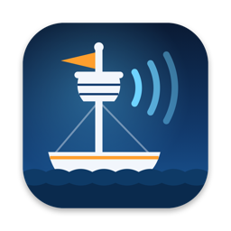

  

<h1 align="center">Crowsnest</h1>

  Native Kubernetes management for Mac and iPad. 
  <a href="https://www.altiros.com/crowsnest/">Website</a> ·
  <a href="https://github.com/altiros/crowsnest/releases">Releases</a> ·
  <a href="https://github.com/altiros/crowsnest/issues">Issues</a> ·
  <a href="https://github.com/altiros/crowsnest/discussions">Discussions</a>

---

Crowsnest is a native app for managing Kubernetes clusters, built with SwiftUI for macOS and iPadOS.
See the health of your cluster at a glance, find any resource in a few clicks and get the everyday work
done right in the app.

This repository hosts the **releases** and the **issue tracker**. The source code is not public.

> **Status:** preview. The macOS version is coming to [Releases](https://github.com/altiros/crowsnest/releases) soon;
> the iPad version will follow via TestFlight / the App Store. Watch this repository (*Watch → Custom → Releases*)
> to get notified.

## Features

- **Cluster overview** – nodes, pods, deployments and warnings at a glance; CPU and memory usage
  vs. requests and allocatable, with history charts
- **Resource browser** – Workloads, Config, Network, Storage, Access Control and Custom Resources,
  including CRDs with their printer columns
- **Details panel** – overview, YAML, live logs and events for every resource
- **Metrics** (via metrics-server) – CPU/memory per pod, container, workload, namespace and node,
  compared with requests and limits
- **YAML editor** – syntax highlighting, live validation, server-side dry run and server-side apply,
  templates for new resources
- **Pod shell** – a terminal inside any container
- **Port forwarding** – to pods and services, with an overview of active forwards
- **Actions** – scale, rollout restart, cordon/uncordon, trigger a CronJob, delete
- **Multiple clusters** – every context of your kubeconfig
- **Authentication** – client certificates, tokens and, on the Mac, exec plugins (`aws`, `gke-gcloud-auth-plugin`, `kubelogin`, …)

## Requirements

- macOS 15 or later
- iPadOS 18 or later (kubeconfigs are imported from the Files app or the clipboard; exec plugins are not available on iPad)
- A Kubernetes cluster you can reach; metrics need [metrics-server](https://github.com/kubernetes-sigs/metrics-server)

## Privacy

- No account, no sign-up.
- No telemetry and no cloud service in between: Crowsnest talks directly to your clusters' API servers.
- Your kubeconfig, certificates and tokens stay on your device.

## Feedback

- **Bugs:** [open an issue](https://github.com/altiros/crowsnest/issues/new/choose) using the bug report template.
- **Ideas and feature requests:** [feature request](https://github.com/altiros/crowsnest/issues/new/choose) or start a
  [discussion](https://github.com/altiros/crowsnest/discussions).
- **Security issues:** please do **not** open a public issue – see [SECURITY.md](SECURITY.md).

> ⚠️ Issues are public. Never paste kubeconfigs, tokens, certificates, secrets or other confidential data
> (internal hostnames, IP addresses, customer names) into an issue. Redact logs and YAML before posting.

## About

Crowsnest is made by [Altiros](https://www.altiros.com). © Altiros GmbH. All rights reserved.
Kubernetes is a registered trademark of The Linux Foundation. Crowsnest is not affiliated with or endorsed by
The Linux Foundation or the CNCF. Mac, macOS, iPad and iPadOS are trademarks of Apple Inc.
